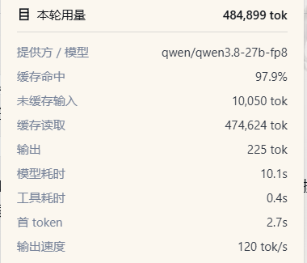

# dsh-tps-ttft

Per-turn TPS and TTFT statistics for [DeepSeek Harness](https://github.com/deepseek-ai/deepseek-harness): model time, tool time, time-to-first-token (TTFT), and output speed (TPS) per turn, shown in the Turn Usage panel.

## What it does

After each turn completes, click the "Turn Usage" icon (database icon). The expanded panel shows timing statistics:



- **Model time**: Wall-clock time for model inference (step/start → assistant/message)
- **Tool time**: Total time for tool calls (tool/call → tool/result)
- **TTFT**: Time to first token (step/start → first token)
- **Output speed**: Output speed in tokens/sec (decodeTokens / decodeMs)

The original token usage information is unchanged:


Session-level statistics:


## Installation

Install directly from GitHub (pinned to a commit, recommended):

```bash
dsh plugin --profile <your-profile> add github:oldzhang82/dsh-tps-ttft#<commit-sha>
```

> Use the latest full SHA from the [commits page](https://github.com/oldzhang82/dsh-tps-ttft/commits/main). Pinning the commit prevents later pushes from silently changing what gets installed.

**The first install will fail** (pnpm ≥10 refuses to run build scripts of git dependencies by default). Authorize it once:

1. Copy the package key printed by pnpm **verbatim** into the profile's `pnpm-workspace.yaml` (the key includes the full tarball URL; use pnpm's actual output):

   ```yaml
   allowBuilds:
     dsh-tps-ttft@https://codeload.github.com/oldzhang82/dsh-tps-ttft/tar.gz/<commit-sha>: true
   ```

2. Re-run the `add` command above.

> This plugin is pure JS; its `prepare` script is a no-op (no build runs), so the authorization carries no real risk.

Restart DSH to apply.

## How it works

This plugin registers a **session projection** (`perTurnStats`) that performs a pure fold over the session event stream:

- Listens to `step/start`, `assistant/attempt`, `assistant/message`, `tool/call`, `tool/result`, and `turn/end` events
- Accumulates model time, tool time, TTFT, and output speed per turn
- Cleans up per-turn transient state at `turn/end` to keep the view bounded

The projection result is displayed via DSH's core `TurnUsagePanel` component (the core code has been integrated with timing display).

## Dependencies

- `zod` ^4.6.5 (schema validation)

## License

MIT
