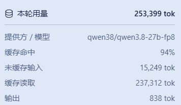
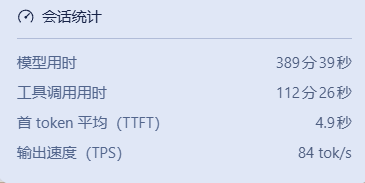

# dsh-tps-ttft

Per-turn TPS and TTFT statistics for [DeepSeek Harness](https://github.com/deepseek-ai/deepseek-harness): model time, tool time, time-to-first-token (TTFT), and output speed (TPS) per turn, shown in the Turn Usage panel.

## What it does

<!-- TODO: Insert screenshots -->


After each turn completes, click the "Turn Usage" icon (database icon). The expanded panel shows:

- **Model time**: Wall-clock time for model inference (step/start → assistant/message)
- **Tool time**: Total time for tool calls (tool/call → tool/result)
- **TTFT**: Time to first token (step/start → first token)
- **Output speed**: Output speed in tokens/sec (decodeTokens / decodeMs)

<!-- TODO: Insert screenshots -->


## Installation

```bash
# In your DSH profile directory
pnpm add dsh-tps-ttft
```

Then add `dsh-tps-ttft` to the `dsh.profile.bundles` array in `package.json`:

```json
{
  "dsh": {
    "profile": {
      "bundles": [
        "dsh-tps-ttft"
      ]
    }
  }
}
```

Restart DSH to apply.

## How it works

This plugin registers a **session projection** (`perTurnStats`) that performs a pure fold over the session event stream:

- Listens to `step/start`, `assistant/attempt`, `assistant/message`, `tool/call`, `tool/result`, and `turn/end` events
- Accumulates model time, tool time, TTFT, and output speed per turn
- Cleans up per-turn transient state at `turn/end` to keep the view bounded

The projection result is displayed via DSH's core `TurnUsagePanel` component (the core code has been integrated with timing display).

## Dependencies

- `zod` ^4.6.5 (schema validation)

## License

MIT
